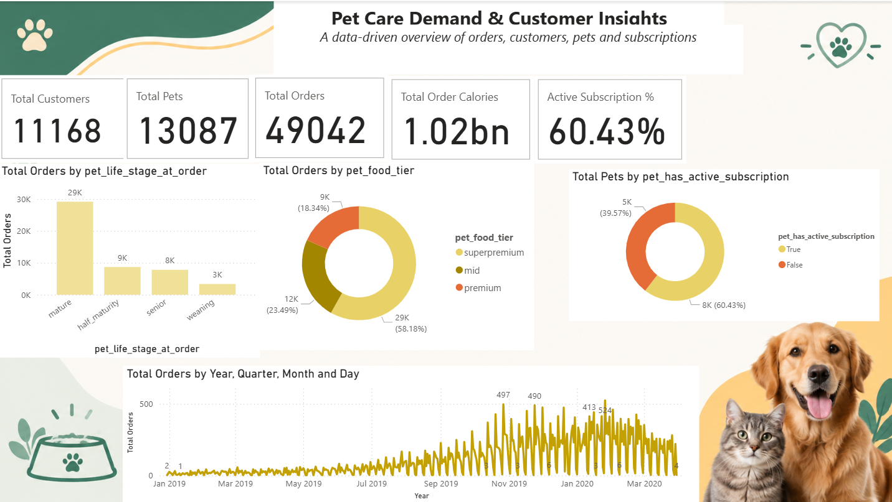

# Pet Care Customer Analytics

### Customer Segmentation | Demand Analysis | Power BI

An end-to-end data analytics project focused on understanding pet food purchasing behavior, customer segmentation, subscription trends, and customer engagement using Python, statistical analysis, and Power BI.

## Project Overview

This project analyzes 49,042 pet food orders to identify customer purchasing patterns, product preferences, subscription behavior, and engagement trends.

The findings are presented through four interactive Power BI dashboards designed to support data-driven business decisions.

## Dataset

- Total Orders: 49,042
- Unique Customers: 11,168
- Unique Pets: 13,087
- Dataset: Pet Food Customer Orders Online (Kaggle)

## Technologies Used

- Python
- Pandas and NumPy
- Matplotlib and Seaborn
- SciPy and Statsmodels
- Exploratory Data Analysis (EDA)
- Statistical Hypothesis Testing
- Power BI
- Power Query
- DAX

## Project Workflow

1. Data Cleaning and Preprocessing
2. Exploratory Data Analysis
3. Customer Segmentation
4. Statistical Hypothesis Testing
5. Power BI Dashboard Development
6. Business Insights and Recommendations

## Statistical Analysis

Applied statistical techniques including:

- Chi-Square Test
- Levene's Test
- Welch's ANOVA
- Pairwise Comparisons

These tests helped examine relationships between subscription status, product preferences, customer characteristics, and purchasing behavior.

## Power BI Dashboards

### 1. Overview

### 2. Customer Segmentation

### 3. Product and Order Behavior

### 4. Customer Engagement

## Key Findings

- Approximately 67% of orders were associated with active subscriptions.
- Superpremium food accounted for approximately 58% of orders.
- Customer purchasing and engagement patterns varied across pet life stages.
- Subscription status showed statistically significant associations with food tier, life stage, and breed size.

## Project Files

- Python Analysis: `Notebooks/CP_python.ipynb`
- Power BI Dashboard: `Powerbi/CP-1.pbix`
- Project Reports: `Reports/`
- Dashboard Screenshots: `Screenshots/`
- Python Dependencies: `Requirements.txt`

All project files are available inside the `Pet-Care-Customer-Analytics` folder.

## Conclusion

This project demonstrates how exploratory data analysis, statistical testing, customer segmentation, and interactive business intelligence dashboards can uncover actionable insights in the pet care industry.
